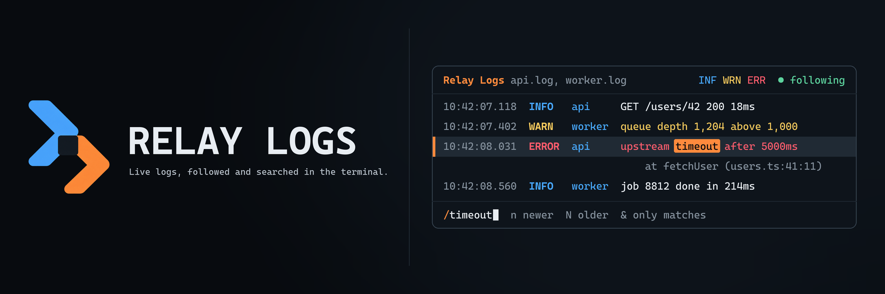

<p align="center">
  
</p>

Relay Logs is a live log viewer for the terminal. It follows files as they grow, recognizes the level, timestamp, and message of each line, whether the line is plain text, JSON, or logfmt, and lets you filter by level and search as new lines arrive.

## Try the demo

```sh
npm install
npm run demo
```

The demo opens a sample service log with text, JSON, and logfmt lines, a warning, and an error with its stack trace. Press `/` and type `timeout` to search, `1`–`6` to hide or show levels, `?` for the keyboard reference, and `q` to quit.

For a demonstration that prints the log and exits:

```sh
npm run demo:plain
```

## Follow a log

```sh
relay-logs -f app.log
relay-logs -f -n 50 api.log worker.log
```

`-f` keeps reading files as they grow, like `tail -F`. It starts with the last 10 lines of each file, or the number given with `-n`. A line appears only once its line ending has been written, a truncated file is read again from the start, a file replaced by log rotation is read from its first line, and a file that does not exist yet is waited for. Lines from several files are interleaved in the order they arrive.

In a terminal, files open in the interactive viewer. When output is piped or the log arrives on standard input, each line is printed colored by its level instead, and `--plain` does the same in a terminal:

```sh
npm run dev 2>&1 | relay-logs
```

## Viewer controls

| Key             | Action                                                        |
| --------------- | ------------------------------------------------------------- |
| `↑`, `k`        | Select the previous line and pause following                  |
| `↓`, `j`        | Select the next line; reaching the newest line resumes        |
| `PgUp`, `b`     | Move up a page                                                |
| `PgDn`, `space` | Move down a page                                              |
| `g`, `G`        | Jump to the first line or follow the newest one               |
| `f`             | Pause or resume following                                     |
| `1`–`6`         | Show or hide trace, debug, info, warn, error, and fatal lines |
| `/`             | Search with a regular expression and highlight matches        |
| `n`, `N`        | Jump to the next newer or older match                         |
| `&`             | Show only matching lines, or all lines again                  |
| `Esc`           | Clear the search                                              |
| `c`             | Clear the lines read so far                                   |
| `q`             | Quit                                                          |
| `?`             | Open the keyboard reference                                   |

The viewer keeps the newest 50,000 lines. The complete reference is in [the keyboard guide](./docs/keyboard.md).

## Filter

```sh
relay-logs -l warn app.log
relay-logs -f -g timeout -g refused -x /health api.log
```

`-l` shows only entries at a level or above. Lines without a recognizable level are hidden by `-l`, except indented lines such as stack frames, which stay with the entry above them. `-g` keeps lines matching a regular expression and `-x` hides them; both may be repeated, and patterns ignore case unless they contain an uppercase letter.

## Use with Relay Cards

`--format cards` writes each entry in the form [Relay Cards](https://github.com/relay-cli/relay-cards) turns into a card:

```sh
relay-logs -f -l warn --format cards api.log | relay-cards
```

Errors become error cards that collect the stack frames below them, warnings become warning cards, and JSON records become JSON cards. `--format json` writes one object per entry with `time`, `level`, `source`, and `message`, whatever format the log was in.

## Use with Log Howl

Relay Logs reads the alerts [Log Howl](https://github.com/dispersal-wolves/log-howl) prints, showing each one at its severity with the rule that raised it:

```sh
log-howl watch --config rules.json >> alerts.jsonl &
relay-logs -f alerts.jsonl
```

Following the alert file keeps the interactive viewer available. Alerts can also be piped straight into `relay-logs --format cards | relay-cards`.

## Documentation

- [Architecture](./docs/architecture.md)
- [Recognized lines and output formats](./docs/formats.md)
- [Keyboard reference](./docs/keyboard.md)

## Scope

Relay Logs reads, filters, and displays logs on the machine it runs on. Alerting on log lines belongs in a watcher such as Log Howl, and shipping logs to another host is left to the tools built for it.

## Development

```sh
npm install
npm run check
```

`npm run check` verifies formatting, linting, strict types, tests, and the distributable package. Relay Logs requires Node.js 22 or newer.

## License

MIT
